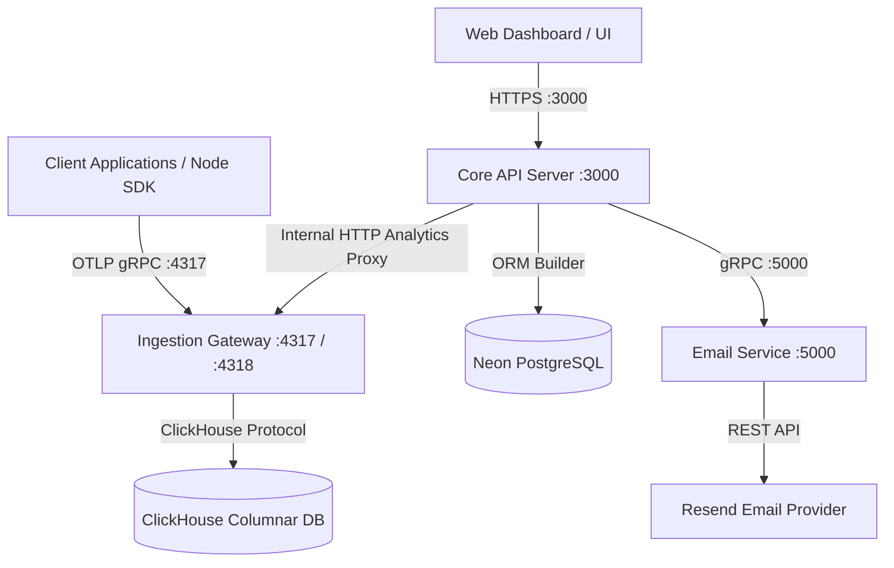

# Agamotto

Next-generation, high-performance distributed observability and telemetry platform designed for deep trace analysis, metrics aggregation, log streaming, and AI-driven automated root-cause diagnostics.

---

## Architecture Overview

Agamotto is structured as a distributed microservices platform built for high throughput and sub-millisecond telemetry ingestion:



---

## Microservices & Observability Core

All microservices (`server`, `email-service`, `ingestion-gateway`) are natively instrumented with OpenTelemetry SDK v3, featuring:

### 1. System & Runtime Observable Gauges
Scraped every 60 seconds via `PeriodicExportingMetricReader` and written to ClickHouse's `metric_samples` table:
* `process.memory.usage` (Bytes): Labeled with `memory.type` (`heap_used`, `heap_total`, `rss`, `system_used`, `system_total`).
* `process.cpu.utilization` (Percent): Delta CPU usage normalized across total machine cores (`0.00%` - `100.00%`).

### 2. Auto-Instrumentation & Application Metrics
* **Auto-Instrumentation**: Configured with `@opentelemetry/auto-instrumentations-node` for automatic Express, HTTP, and gRPC tracking.
* **Request Counters & Latencies**:
  * `http.server.request.count` & `http.server.request.duration` (ms) on all incoming HTTP endpoints.
  * `rpc.server.request.count` & `rpc.server.duration` (ms) on all incoming gRPC endpoints.
  * `rpc.client.request.count` & `rpc.client.duration` (ms) on outbound gRPC calls.
  * `email.sent.count` & `email.failure.count` on transactional email dispatch.

### 3. Correlated Structured Logging
* **Automatic Trace Context Correlation**: Active trace context (`trace_id`, `span_id`) is automatically injected into all log entries.
* **Console Interception**: `startTelemetry()` hooks global `console.log`, `console.info`, `console.warn`, and `console.error` to stream all console outputs directly to ClickHouse's `telemetry_logs` table while preserving stdout.
* **Structured Logger**: `logger(serviceName)` provides custom structured attributes for domain events.

---

## API Reference

### Authentication (`/auth`)
| Method | Endpoint | Description |
|---|---|---|
| `POST` | `/auth/signup` | Register new account and trigger OTP email |
| `POST` | `/auth/verify-email` | Verify OTP code and activate account |
| `POST` | `/auth/login` | Authenticate user with password |
| `POST` | `/auth/refresh` | Rotate refresh token and issue new access token |
| `POST` | `/auth/logout` | Revoke session and clear authentication cookies |
| `GET` | `/auth/me` | Fetch currently authenticated user profile |
| `GET` | `/auth/google` | Initiate Google OAuth 2.0 flow |
| `GET` | `/auth/github` | Initiate GitHub OAuth 2.0 flow |

### Permissions Catalog (`/permissions`)
| Method | Endpoint | Description |
|---|---|---|
| `GET` | `/permissions` | List all 15 master platform permissions |

### Organizations (`/orgs`)
| Method | Endpoint | Required Permission | Description |
|---|---|---|---|
| `POST` | `/orgs` | Authenticated | Create a new organization & provision default groups |
| `GET` | `/orgs` | Authenticated | List all organizations current user belongs to |
| `GET` | `/orgs/:orgId` | `org:read` | Get organization details |
| `PATCH` | `/orgs/:orgId` | `org:update` | Update organization name or slug |
| `DELETE` | `/orgs/:orgId` | `org:delete` | Delete organization and all associated resources |

### Organization Members (`/orgs/:orgId/members`)
| Method | Endpoint | Required Permission | Description |
|---|---|---|---|
| `GET` | `/orgs/:orgId/members` | `members:read` | List organization members and their groups |
| `POST` | `/orgs/:orgId/members` | `members:invite` | Add user to organization with group assignment |
| `DELETE` | `/orgs/:orgId/members/:memberId` | `members:remove` | Remove member from organization |

### Groups & Permissions (`/orgs/:orgId/groups`)
| Method | Endpoint | Required Permission | Description |
|---|---|---|---|
| `GET` | `/orgs/:orgId/groups` | `groups:read` | List all groups in organization |
| `POST` | `/orgs/:orgId/groups` | `groups:manage` | Create custom organization group |
| `GET` | `/orgs/:orgId/groups/:groupId` | `groups:read` | Get group details with permissions and members |
| `PATCH` | `/orgs/:orgId/groups/:groupId` | `groups:manage` | Update group name or description |
| `DELETE` | `/orgs/:orgId/groups/:groupId` | `groups:manage` | Delete custom group |
| `POST` | `/orgs/:orgId/groups/:groupId/permissions` | `groups:assign_permissions` | Assign permission to group |
| `DELETE` | `/orgs/:orgId/groups/:groupId/permissions/:permId` | `groups:assign_permissions` | Remove permission from group |
| `POST` | `/orgs/:orgId/groups/:groupId/members` | `groups:assign_members` | Assign member to group |
| `DELETE` | `/orgs/:orgId/groups/:groupId/members/:memberId` | `groups:assign_members` | Remove member from group |

### Ingest Keys (`/orgs/:orgId/keys`)
| Method | Endpoint | Required Permission | Description |
|---|---|---|---|
| `GET` | `/orgs/:orgId/keys` | `ingest_keys:read` | List telemetry ingest keys (hashes hidden) |
| `POST` | `/orgs/:orgId/keys` | `ingest_keys:create` | Generate new ingest key |
| `PATCH` | `/orgs/:orgId/keys/:keyId` | `ingest_keys:revoke` | Toggle ingest key active state |
| `DELETE` | `/orgs/:orgId/keys/:keyId` | `ingest_keys:revoke` | Revoke and delete ingest key |

---

## Analytics & Observability Engine (`/analytics` or `/orgs/:orgId/analytics`)

Dedicated analytics control plane querying ClickHouse columnar datasets. All endpoints require `org:read` permission. The organization ID can be supplied in route path (`/orgs/:orgId/analytics/...`), query string (`?orgId=...`), or header (`x-org-id` / `x-organization-id`).

### Global Analytics
| Method | Endpoint | Query Parameters | Description |
|---|---|---|---|
| `GET` | `/analytics/overview` | `since`, `until` | High-level system KPI card (total spans, requests, error rate, p50, p95, p99, active services) |
| `GET` | `/analytics/latency` | `since`, `until`, `service` | Detailed latency percentiles per microservice (p50, p90, p95, p99, p99.9, avg, min, max) |
| `GET` | `/analytics/latency/timeseries` | `since`, `until`, `service` | Minute-by-minute timeseries of p50, p95, p99 latency per service |
| `GET` | `/analytics/throughput` | `since`, `until`, `service` | Minute-by-minute request volume and Requests Per Second (RPS) per service |
| `GET` | `/analytics/endpoints` | `since`, `until`, `service`, `page`, `limit` | Paginated route-level breakdown with call count, error count, error rate, p50, p95, and p99 ms |
| `GET` | `/analytics/services` | `since`, `until` | Service overview ranking services by errors, call volume, and p99 latency |
| `GET` | `/analytics/dependency-graph` | `since`, `until` | Distributed service caller -> callee dependency graph with call volume, error count, and edge p99 latency |
| `GET` | `/analytics/errors` | `since`, `until`, `service`, `page`, `limit` | Paginated error aggregates grouped by service and endpoint with last-seen timestamps |
| `GET` | `/analytics/logs` | `since`, `until`, `regex`, `search`, `severity`, `service`, `traceId`, `page`, `limit` | Paginated log search with ReDoS-safe regex matching and severity filtering |
| `GET` | `/analytics/metrics` | `since`, `until`, `name`, `service` | Timeseries metric points (avg, min, max, sample count) from `metric_samples` |
| `GET` | `/analytics/resources/overview` | `since`, `until` | Current snapshot of CPU % utilization and memory consumption (heap, RSS, OS) across microservices |
| `GET` | `/analytics/resources/cpu` | `since`, `until`, `service` | Timeseries of CPU % utilization (avg, peak, p95) per service |
| `GET` | `/analytics/resources/memory` | `since`, `until`, `service` | Timeseries of heap used, total heap, RSS, and OS memory consumption per service |
| `GET` | `/analytics/email-metrics` | `since`, `until` | Email delivery statistics (total sent vs. failed, broken down by template and failure reason) |
| `GET` | `/analytics/traces` | `since`, `until`, `service`, `status`, `minDurationMs`, `page`, `limit` | Paginated distributed trace search |
| `GET` | `/analytics/traces/:traceId` | N/A | Chronological flat list of all spans within a distributed trace |
| `GET` | `/analytics/trace-flow/:traceId` | N/A | Hierarchical parent-child tree structure for trace waterfall visualization |

### Nested Per-Microservice Exploration
Deep-dive telemetry scoped strictly to a single selected microservice:

| Method | Endpoint | Query Parameters | Description |
|---|---|---|---|
| `GET` | `/analytics/services/:serviceName/overview` | `since`, `until` | Service health card (total spans, requests, error rate, p50, p95, p99, avg, min, max) |
| `GET` | `/analytics/services/:serviceName/endpoints` | `since`, `until`, `page`, `limit` | Paginated breakdown of all routes within this microservice |
| `GET` | `/analytics/services/:serviceName/traces` | `since`, `until`, `status`, `minDurationMs`, `page`, `limit` | Paginated traces that executed through this microservice |
| `GET` | `/analytics/services/:serviceName/logs` | `since`, `until`, `regex`, `search`, `severity`, `page`, `limit` | Paginated logs emitted by this microservice with regex search |
| `GET` | `/analytics/services/:serviceName/metrics` | `since`, `until`, `name` | Timeseries metrics emitted by this microservice |
| `GET` | `/analytics/services/:serviceName/errors` | `since`, `until`, `page`, `limit` | Paginated errors originating from this microservice |

### Pagination Standard
All paginated endpoints accept `page` (default: `1`) and `limit` (default: `50`, max: `200`) and return:
```json
{
  "data": [ ... ],
  "pagination": {
    "page": 1,
    "limit": 50,
    "hasMore": true
  },
  "meta": {
    "duration_ms": 12.4
  }
}
```

---

## Local Development Setup

### Prerequisites
- Node.js v22+
- Docker and Docker Compose
- Access to a PostgreSQL instance (or Neon connection string)
- Access to a ClickHouse instance

### Environment Variables
Configure `.env` files for each service:

```bash
# server/.env
DATABASE_URL="postgresql://<user>:<password>@<host>/<database>?sslmode=require"
PORT=3000
FRONTEND_URL="http://localhost:5173"
JWT_SECRET="<your-access-token-secret>"
JWT_REFRESH_SECRET="<your-refresh-token-secret>"
EMAIL_SERVICE_HOST="localhost"
EMAIL_SERVICE_PORT=5000
OTEL_EXPORTER_OTLP_ENDPOINT="localhost:4317"
AGAMOTTO_API_KEY="<your-ingestion-key>"
ANALYTICS_GATEWAY_URL="http://localhost:4318"
ANALYTICS_INTERNAL_TOKEN="<shared-internal-token>"
```

### Running Locally
1. Start the Email Service:
   ```bash
   cd email-service
   npm install
   npm start
   ```
2. Start the Telemetry Ingestion Gateway:
   ```bash
   cd ingestion-gateway
   npm install
   npm start
   ```
3. Start the API Server:
   ```bash
   cd server
   npm install
   npm start
   ```
