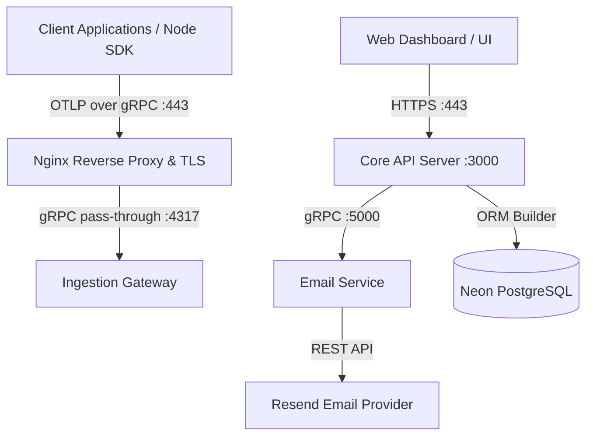

# Agamotto

Next-generation, high-performance distributed observability and telemetry platform designed for deep trace analysis, metrics aggregation, log streaming, and AI-driven automated root-cause diagnostics.

---

## Architecture Overview

Agamotto is structured as a distributed microservices platform built for high throughput and sub-millisecond telemetry ingestion:



---

## Services & Components

### 1. Core API Server (`server/`)
The primary application control plane providing multi-tenant authentication, organization lifecycle management, AWS-style role-based access control (RBAC), and ingest key management.

- **Technology**: Node.js (ES Modules, Node 22+ type stripping), Express 5, Prisma 8 ORM (`@prisma/orm-postgres`).
- **Database**: Serverless PostgreSQL (Neon) with strictly UUID-based relational models.
- **Authentication**:
  - Email & password signup with bcrypt password hashing and client-side password confirmation verification.
  - One-time password (OTP) verification delivered via the gRPC email microservice.
  - Refresh token rotation with SHA-256 token hashing and session persistence (`UserSession`).
  - Google and GitHub OAuth 2.0 integrations via Passport strategies.
  - Dual HTTP-only cookie and Authorization Bearer header support.
- **Multi-Tenant RBAC & Groups**:
  - Granular permissions model across 5 categories (`ORGANIZATION`, `MEMBERS`, `GROUPS`, `INGEST_KEYS`, `TELEMETRY`).
  - Automated provisioning of 4 system groups (`SUPER_ADMIN`, `ADMIN`, `DEVELOPER`, `VIEWER`) on organization creation.
  - Member assignment to multiple groups with dynamic permission union resolution.
  - Wildcard full administrative override for members in `SUPER_ADMIN`.
  - Built-in safeguards preventing removal of the organization creator or last Super Admin.
- **Telemetry Ingest Key Management**:
  - Secure random key generation (`ak_live_<random_bytes>`).
  - SHA-256 one-way hashing: raw secret keys are returned only once upon creation.
  - Fast prefix identification (`ak_live_...`) and instant key deactivation / revocation.

### 2. Email Microservice (`email-service/`)
A dedicated high-performance internal microservice handling transactional email dispatching.

- **Technology**: Node.js, `@grpc/grpc-js`, `@grpc/proto-loader`, Resend API.
- **Interface**: gRPC `EmailService` with `SendEmail` RPC listening on port `5000`.
- **Templates**: Custom HTML templates for OTP verification, password resets, and organization invites.

### 3. Telemetry Ingestion Gateway (`ingestion-gateway/`)
High-throughput telemetry receiver handling OpenTelemetry Protocol (OTLP) data streams.

- **Technology**: Node.js / Docker.
- **Protocol**: OTLP over gRPC listening on port `4317`.
- **Network & TLS**: Nginx reverse proxy terminating HTTP/2 and gRPC on port `443` with Let's Encrypt TLS certificates for `ingest.agamotto.tech`.

### 4. CI/CD & Deployment Automation (`.github/workflows/`)
Production-grade deployment pipelines running on push to `main` / `feature-backend`:

- `deploy-server.yml`: Automated testing, Docker image packaging, SSH deployment to VM, zero-downtime container rollout, and `/healthz` probing.
- `deploy-email-service.yml`: Builds and rolls out the gRPC email microservice with health checks.
- `deploy-ingestion-gateway.yml`: Deploys the ingestion gateway service with port 4317 exposure.

---

## API Reference

### Authentication (`/auth`)
| Method | Endpoint | Description |
|---|---|---|
| `POST` | `/auth/signup` | Register new account and trigger OTP email |
| `POST` | `/auth/verify-email` | Verify OTP code and activate account |
| `POST` | `/auth/login` | Authenticate user with password |
| `POST` | `/auth/refresh` | Rotate refresh token and issue new access token |
| `POST` | `/auth/logout` | Revoke session and clear authentication cookies |
| `GET` | `/auth/me` | Fetch currently authenticated user profile |
| `GET` | `/auth/google` | Initiate Google OAuth 2.0 flow |
| `GET` | `/auth/github` | Initiate GitHub OAuth 2.0 flow |

### Permissions Catalog (`/permissions`)
| Method | Endpoint | Description |
|---|---|---|
| `GET` | `/permissions` | List all 15 master platform permissions |

### Organizations (`/orgs`)
| Method | Endpoint | Required Permission | Description |
|---|---|---|---|
| `POST` | `/orgs` | Authenticated | Create a new organization & provision default groups |
| `GET` | `/orgs` | Authenticated | List all organizations current user belongs to |
| `GET` | `/orgs/:orgId` | `org:read` | Get organization details |
| `PATCH` | `/orgs/:orgId` | `org:update` | Update organization name or slug |
| `DELETE` | `/orgs/:orgId` | `org:delete` | Delete organization and all associated resources |

### Organization Members (`/orgs/:orgId/members`)
| Method | Endpoint | Required Permission | Description |
|---|---|---|---|
| `GET` | `/orgs/:orgId/members` | `members:read` | List organization members and their groups |
| `POST` | `/orgs/:orgId/members` | `members:invite` | Add user to organization with group assignment |
| `DELETE` | `/orgs/:orgId/members/:memberId` | `members:remove` | Remove member from organization |

### Groups & Permissions (`/orgs/:orgId/groups`)
| Method | Endpoint | Required Permission | Description |
|---|---|---|---|
| `GET` | `/orgs/:orgId/groups` | `groups:read` | List all groups in organization |
| `POST` | `/orgs/:orgId/groups` | `groups:manage` | Create custom organization group |
| `GET` | `/orgs/:orgId/groups/:groupId` | `groups:read` | Get group details with permissions and members |
| `PATCH` | `/orgs/:orgId/groups/:groupId` | `groups:manage` | Update group name or description |
| `DELETE` | `/orgs/:orgId/groups/:groupId` | `groups:manage` | Delete custom group (system groups protected) |
| `POST` | `/orgs/:orgId/groups/:groupId/permissions` | `groups:assign_permissions` | Assign permission to group |
| `DELETE` | `/orgs/:orgId/groups/:groupId/permissions/:permId` | `groups:assign_permissions` | Remove permission from group |
| `POST` | `/orgs/:orgId/groups/:groupId/members` | `groups:assign_members` | Assign member to group |
| `DELETE` | `/orgs/:orgId/groups/:groupId/members/:memberId` | `groups:assign_members` | Remove member from group |

### Ingest Keys (`/orgs/:orgId/keys`)
| Method | Endpoint | Required Permission | Description |
|---|---|---|---|
| `GET` | `/orgs/:orgId/keys` | `ingest_keys:read` | List telemetry ingest keys (hashes hidden) |
| `POST` | `/orgs/:orgId/keys` | `ingest_keys:create` | Generate new ingest key |
| `PATCH` | `/orgs/:orgId/keys/:keyId` | `ingest_keys:revoke` | Toggle ingest key active state |
| `DELETE` | `/orgs/:orgId/keys/:keyId` | `ingest_keys:revoke` | Revoke and delete ingest key |

---

## Local Development Setup

### Prerequisites
- Node.js v22+
- Docker and Docker Compose
- Access to a PostgreSQL instance (or Neon connection string)

### Environment Variables
Configure `.env` files for each service:

```bash
# server/.env
DATABASE_URL="postgresql://<user>:<password>@<host>/<database>?sslmode=require"
PORT=3000
FRONTEND_URL="http://localhost:5173"
JWT_SECRET="<your-access-token-secret>"
JWT_REFRESH_SECRET="<your-refresh-token-secret>"
EMAIL_SERVICE_HOST="localhost"
EMAIL_SERVICE_PORT=5000
GOOGLE_CLIENT_ID="<client-id>"
GOOGLE_CLIENT_SECRET="<client-secret>"
GITHUB_CLIENT_ID="<client-id>"
GITHUB_CLIENT_SECRET="<client-secret>"
```

### Running Locally
1. Start the Email Service:
   ```bash
   cd email-service
   npm install
   npm start
   ```
2. Start the API Server:
   ```bash
   cd server
   npm install
   npm start
   ```
3. Start the Ingestion Gateway:
   ```bash
   cd ingestion-gateway
   docker build -t ingestion-gateway .
   docker run -p 4317:4317 ingestion-gateway
   ```

---

## Testing & Quality Assurance
- Automated endpoint test suite covering Organization lifecycle, member invitations, custom groups, permission grants, and key revocation:
  - Verified 22/22 routes passing against active database instances.
- Zero-comments coding policy enforced across core server and business logic modules.
- Strict error propagation delegating all asynchronous controller rejections to Express `next(error)` handlers.
