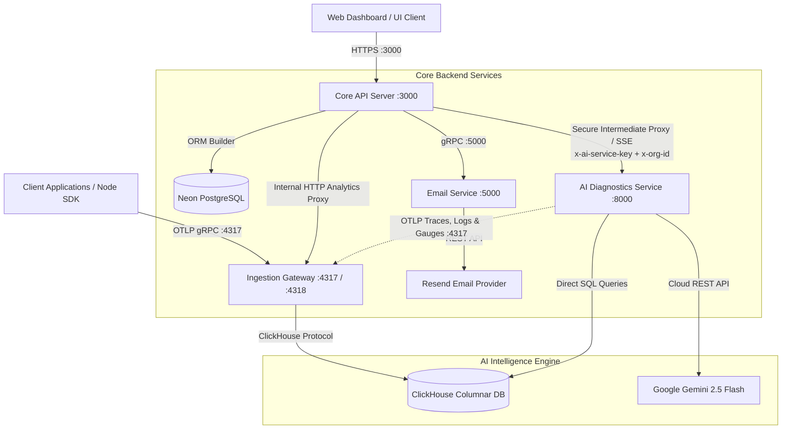

# Agamotto

Next-generation, high-performance distributed observability and telemetry platform designed for deep trace analysis, metrics aggregation, log streaming, and AI-driven automated root-cause diagnostics.

---

## Live Demo & Test Credentials

Explore the live platform at **[https://agamotto.tech](https://agamotto.tech)**:

| Parameter | Value |
|---|---|
| **Platform URL** | [https://agamotto.tech](https://agamotto.tech) |
| **Login Email** | `anmosxn2005@gmail.com` |
| **Password** | `Anmol@20012005` |
| **Active Organization** | Switch to **`agamotto_org`** upon login |

> [!TIP]
> After logging in, switch your active organization in the top navigation bar to **`agamotto_org`** to view all live production metrics, distributed trace waterfalls, correlated logs, and AI-driven root-cause diagnostics.

---

## Architecture Overview

Agamotto is structured as a distributed microservices platform built for high throughput, sub-millisecond telemetry ingestion, and secure multi-tenant AI diagnostics:



> [!IMPORTANT]
> **Strict Tenant & Intermediate Proxy Architecture**: The client UI is **never** directly connected to `ai_service` or raw database ports. All AI requests pass through `Server :3000` via `/orgs/:orgId/ai/*`, which verifies user session JWTs, enforces PostgreSQL organization membership (`org:read`), attaches internal credentials (`x-ai-service-key`), propagates W3C trace context, and streams Server-Sent Events (SSE) back to the client.

---

## Microservices & Observability Core

All microservices (`server`, `email-service`, `ingestion-gateway`, and `ai_service`) are natively instrumented with OpenTelemetry SDKs (Node.js and Python), featuring:

### 1. System & Runtime Observable Gauges
Scraped every 60 seconds via `PeriodicExportingMetricReader` (Node.js) and custom periodic gauge callbacks with `psutil` (Python `ai_service`), written to ClickHouse's `metric_samples` table:
* `process.memory.usage` (Bytes): Labeled with `memory.type` (`heap_used`, `heap_total`, `rss`, `system_used`, `system_total`).
* `process.cpu.utilization` (Percent): Delta CPU usage normalized across total machine cores (`0.00%` - `100.00%`).

### 2. Auto-Instrumentation & Application Metrics
* **Node.js Services**: Configured with `@opentelemetry/auto-instrumentations-node` for automatic Express, HTTP, and gRPC tracking.
* **Python AI Microservice**: Configured with `FastAPIInstrumentor` and custom OTLP span/log batch exporters.
* **Request Counters & Latencies**:
  * `http.server.request.count` & `http.server.request.duration` (ms) on all incoming HTTP endpoints.
  * `rpc.server.request.count` & `rpc.server.duration` (ms) on all incoming gRPC endpoints.
  * `rpc.client.request.count` & `rpc.client.duration` (ms) on outbound gRPC calls.
  * `email.sent.count` & `email.failure.count` on transactional email dispatch.

### 3. Correlated Structured Logging
* **Automatic Trace Context Correlation**: Active trace context (`trace_id`, `span_id`) is automatically injected into all log entries.
* **Console Interception**: `startTelemetry()` hooks global `console.log`, `console.info`, `console.warn`, and `console.error` to stream all console outputs directly to ClickHouse's `telemetry_logs` table while preserving stdout.
* **Structured Logger**: `logger(serviceName)` provides custom structured attributes for domain events.

---

## AI Service (`ai_service`)

The AI Service is a standalone **FastAPI** microservice (Python) that powers all AI and ML features of Agamotto. It runs at `:8000` and connects to both **ClickHouse** (production telemetry) and **DuckDB** (local analytics store) with strict multi-tenant isolation — every query is scoped to the caller's `org_id` extracted from a verified JWT.

### Tech Stack

| Component | Technology |
|---|---|
| Web Framework | FastAPI + Uvicorn |
| Local Analytics Store | DuckDB |
| Production Telemetry Store | ClickHouse |
| AI Agent | LLM tool-calling (via `LLMClient`) |
| MCP Protocol | `mcp >= 2.3.0` — Streamable HTTP/SSE + stdio |
| Auth | PyJWT — Bearer token / cookie |
| HTTP Client | HTTPX (async) |
| Background Scheduler | asyncio task loop (30s tick) |

### Directory Structure

```
ai_service/
├── app/
│   ├── main.py                  # FastAPI app, lifespan, CORS, router registration
│   ├── config.py                # Pydantic settings (env vars)
│   ├── auth.py                  # JWT verification, org_id extraction
│   ├── database.py              # DuckDB + ClickHouse-in-DuckDB federated queries
│   ├── clickhouse.py            # ClickHouse client, schema init
│   ├── llm.py                   # LLMClient — tool-calling wrapper
│   ├── mcp_client.py            # In-process MCP tool caller
│   ├── nl_search.py             # Natural-language search engine (Feature 20)
│   ├── cache.py                 # Answer caching layer
│   ├── schemas.py               # Pydantic models (AiAnswer, Filter, AnomalyOut, …)
│   ├── validator.py             # Evidence validator (Feature 19)
│   ├── agent/
│   │   ├── loop.py              # AI agent execution loop (Feature 9)
│   │   └── prompts/
│   │       ├── system.md        # System prompt for investigation assistant
│   │       └── nl_search.md     # System prompt for NL search
│   ├── anomaly/
│   │   ├── detector.py          # Core anomaly detection state machine (Feature 7)
│   │   ├── baseline.py          # Baseline metrics computation from ClickHouse
│   │   └── suspects.py          # Root-cause suspect span ranking
│   ├── mcp/
│   │   ├── server.py            # MCP server — 8 telemetry tools (Feature 8)
│   │   ├── context.py           # Auth context vars for MCP tool calls
│   │   ├── schemas.py           # MCP-specific Pydantic models
│   │   ├── store_client.py      # DuckDB/ClickHouse read helpers for MCP tools
│   │   └── tools/
│   │       ├── get_service_stats.py
│   │       ├── find_slow_spans.py
│   │       ├── get_error_groups.py
│   │       ├── get_trace.py
│   │       ├── search_logs.py
│   │       ├── compare_traces.py
│   │       ├── get_topology.py
│   │       └── get_anomalies.py
│   ├── jobs/
│   │   └── scheduler.py         # 30-second background anomaly detector loop
│   └── routers/
│       ├── anomalies.py         # GET /anomalies (Feature 7)
│       ├── assistant.py         # POST /ask, POST /ask/sync (Features 9 & 19)
│       ├── evidence.py          # POST /evidence/validate (Feature 19)
│       ├── search.py            # POST /parse-filter, POST /search/execute (Feature 20)
│       ├── telemetry.py         # POST /db/* — federated DuckDB+ClickHouse queries
│       └── mcp.py               # MCP server HTTP mount
├── evals/
│   ├── run_evals.py             # Evaluation harness for NL search accuracy
│   └── datasets/nl_search.jsonl # Ground-truth NL search test cases
├── tests/
│   ├── test_anomaly.py
│   ├── test_assistant.py
│   ├── test_feature_19.py
│   ├── test_feature_20.py
│   └── test_mcp_server.py
├── requirements.txt
└── pyproject.toml
```

---

### Feature 7 — Automated Root-Cause Correlation

**Endpoint:** `GET /anomalies`

A **30-second background scheduler** (`jobs/scheduler.py`) continuously runs a detection cycle across all `(org_id, service_name)` pairs. The detector implements a lifecycle **state machine**:

```
┌─────────┐   threshold met        ┌──────┐
│  normal  │──────────────────────▶│ open │
└─────────┘                        └──┬───┘
     ▲                                │  threshold NOT met
     │  recovery_count >= 2           ▼
     │                         recovery_count++
     └─────────────────────────(closed)
```

**Detection conditions** (both must hold):
- `current_p99 > K × baseline_p99`
- `current_error_rate > baseline_error_rate + MARGIN`
- `span_count >= MIN_SPANS`
- `baseline_p99 > 0` (guard)

**Key properties:**
- **Idempotent upserts** — a stable `anomaly_id` is generated on first detection and reused across ticks; DuckDB serializes writes so concurrent ticks are safe.
- **Suspect ranking** — `anomaly/suspects.py` ranks the slowest contributing spans inside the anomaly window, exposing `span_id`, `span_name`, `service_name`, `duration_ns`, `self_time_ns`, and `is_error`.
- **Baseline computation** — `anomaly/baseline.py` computes rolling baselines from the past 7 days of ClickHouse `canonical_spans`, falling back gracefully when data is sparse.

**Response shape:**
```json
{
  "anomalies": [
    {
      "anomaly_id": "uuid",
      "service_name": "payment",
      "window_start": "2026-10-28T10:00:00Z",
      "window_end": "2026-10-28T10:01:00Z",
      "p99_ns": 4500000000,
      "baseline_p99_ns": 900000000,
      "ratio": 5.0,
      "error_rate": 0.34,
      "baseline_error_rate": 0.02,
      "status": "open",
      "summary": "payment p99 is 5.0× its baseline (4500 ms vs 900 ms baseline) and errors are at 34.0%",
      "suspects": [...]
    }
  ],
  "total": 1
}
```

---

### Feature 8 — Eye of Agamotto MCP Server

**Mount:** `/mcp` (Streamable HTTP/SSE) and `stdio` transport

A **Model Context Protocol (MCP)** server named `eye-of-agamotto-mcp` exposes **8 read-only telemetry tools** to LLMs and external AI clients. All tools enforce strict multi-tenant isolation — `org_id` and `visible_services` are read from the verified JWT; raw SQL access is never exposed.

| Tool | Description |
|---|---|
| `get_service_stats` | P50/P99 latency, request rate, error rate for one or all services in a time window |
| `find_slow_spans` | Top N slowest spans matching a service / operation name filter |
| `get_error_groups` | Error groups by exception type and operation, with occurrence counts |
| `get_trace` | Full trace tree with all child spans for a given `trace_id` |
| `search_logs` | Full-text and regex search across telemetry logs with severity filter |
| `compare_traces` | Side-by-side comparison of two traces highlighting latency and status differences |
| `get_topology` | Service dependency graph as a list of directed `(source → destination)` edges with call counts |
| `get_anomalies` | Active anomalies from the detector for the authenticated organization |

**Security features:**
- Admin kill-switch per tool via `settings.mcp_tools_disabled`
- Prevents write operations and raw SQL passthrough
- All tool results capped at 6,000 characters to prevent context overflow

---

### Features 9 & 19 — AI Investigation Assistant with Clickable Evidence

**Endpoints:**
- `POST /ask` — Streaming SSE response
- `POST /ask/sync` — Non-streaming direct response (for API clients & tests)
- `POST /investigations/share` — Stores a shareable investigation snapshot
- `POST /evidence/validate` — Validates AI answer evidence against live telemetry stores
- `GET /evidence/check/{kind}/{item_id}` — Verifies a single span, log, or trace ID
- `GET /evidence/health` — Checks DuckDB and ClickHouse connectivity

The **AI Investigation Assistant** (`agent/loop.py`) lets users ask natural-language questions about their telemetry — e.g. _"Why is the payment service slow?"_ The agent:

1. **Pre-loads context** cheaply from the provided `anomaly_id`, `trace_id`, or `span_id`.
2. **Calls MCP tools** iteratively (up to 8 calls, 45-second timeout) to gather real telemetry evidence.
3. **Streams SSE events** to the client in real time:

| Event | Payload |
|---|---|
| `tool_start` | Tool name and arguments being dispatched |
| `tool_result` | Tool response data (capped to 6,000 chars) |
| `answer` | Final `AiAnswer` JSON conforming to Pydantic schema |
| `error` | Unrecoverable failure description |

4. **Validates every citation** (Feature 19) — the `validator.py` module checks every `span_id`, `log_id`, and `trace_id` in the answer against DuckDB and ClickHouse:
   - Drops **hallucinated** evidence items (IDs that don't exist in the store).
   - Drops **cross-tenant** evidence (IDs belonging to a different `org_id`).
   - Enriches verified items with real attributes (latency, error flag, deep-link URL).
   - Downgrades or removes hypotheses with no valid evidence left.
   - Sets `insufficient_evidence: true` if nothing valid remains after filtering.

5. **Retries once** on Pydantic validation failure before returning an error event.

**Answer schema (`AiAnswer`):**
```json
{
  "summary": "The payment service is experiencing a 5× latency spike...",
  "hypotheses": [
    {
      "title": "Database connection pool exhaustion",
      "confidence": 0.85,
      "evidence": [
        {
          "kind": "span",
          "item_id": "abc123",
          "label": "db.query took 4.2s",
          "url": "/traces/abc123"
        }
      ]
    }
  ],
  "insufficient_evidence": false
}
```

---

### Feature 20 — Natural-Language Search

**Endpoints:**
- `POST /parse-filter` — Converts a natural-language query into a structured `Filter` object and UI chips
- `POST /search/execute` — Executes a `Filter` directly against DuckDB and ClickHouse
- `GET /search/services` — Lists known service names for the tenant
- `GET /search/events/latest-deploy` — Returns the latest deployment event timestamp

The NL Search engine (`nl_search.py`) lets users type free-form queries into the Logs or Traces search bar — e.g. _"errors in the payment service in the last 15 minutes"_ — and converts them into structured filters.

**Pipeline:**

```
User query
    │
    ├─► Security gate: SQL injection + prompt injection detection (rejects or neutralizes)
    │
    ├─► Service discovery: Queries DuckDB & ClickHouse for known org services
    │
    ├─► Relative time resolution:
    │     "last 15 minutes" → from/to timestamps
    │     "since the deploy" → looks up latest deploy event from events table
    │     "today", "yesterday", "last 7 days" → exact UTC ranges
    │
    ├─► LLM tool-calling parser (primary) with deterministic rule-based parser (fallback)
    │
    ├─► Filter validation & sanitization:
    │     • Only known services allowed
    │     • Valid OTel severities (TRACE, DEBUG, INFO, WARN, ERROR, FATAL)
    │     • Regex ≤ 200 chars and must compile
    │     • Time range ≤ plan retention limit
    │     • Result limit ≤ 1,000
    │
    └─► ParseFilterResponse: structured Filter + editable UI chips ("Interpreted as" row)
```

**Security protections built-in:**
- SQL injection pattern detection (DROP, DELETE, UNION SELECT, etc.)
- Prompt injection detection (`ignore all previous instructions`, `system prompt override`, etc.)
- Dangerous inputs are treated as literal text — never executed as SQL

**Example:**
```
Input:  "show me ERROR logs from the checkout service since the last deploy"

Output Filter:
{
  "services": ["checkout"],
  "severities": ["ERROR"],
  "from_time": "2026-10-28T05:30:00Z",   ← resolved from latest deploy event
  "to_time":   "2026-10-28T22:12:44Z",
  "limit": 100
}

Chips: ["Service: checkout", "Severity: ERROR", "Since: last deploy (Oct 28 05:30 UTC)"]
```

---

### Federated Database Layer (`/db`)

**Endpoints:**
- `POST /db/clickhouse/query` — Execute a parameterized ClickHouse SELECT
- `POST /db/duckdb/query` — Execute a DuckDB SQL query against the local store
- `POST /db/federated` — Run a ClickHouse query as a virtual DuckDB table, then apply DuckDB SQL on top
- `POST /db/sync` — Sync a ClickHouse table slice into DuckDB for offline analytics
- `GET /db/health` — DuckDB + ClickHouse connectivity check

The database layer enables **federated analytics** — ClickHouse data is registered as a virtual Arrow table inside DuckDB, allowing complex cross-store joins and aggregations without data movement.

---

## AI Service API Reference

### Anomalies
| Method | Endpoint | Description |
|---|---|---|
| `GET` | `/anomalies` | List active anomalies for the authenticated org with suspect spans |

### AI Investigation Assistant
| Method | Endpoint | Description |
|---|---|---|
| `POST` | `/ask` | Stream SSE investigation events (`tool_start`, `tool_result`, `answer`, `error`) |
| `POST` | `/ask/sync` | Non-streaming investigation response |
| `POST` | `/investigations/share` | Save a shareable investigation snapshot |

### Evidence Validation
| Method | Endpoint | Description |
|---|---|---|
| `POST` | `/evidence/validate` | Validate all span/log/trace citations in an `AiAnswer` |
| `GET` | `/evidence/check/{kind}/{item_id}` | Verify a single evidence item (`span`, `log`, `trace`) |
| `GET` | `/evidence/health` | Check DuckDB + ClickHouse readiness |

### Natural-Language Search
| Method | Endpoint | Description |
|---|---|---|
| `POST` | `/parse-filter` | Convert NL query to structured `Filter` + UI chips |
| `POST` | `/search/execute` | Execute a `Filter` against DuckDB and ClickHouse |
| `GET` | `/search/services` | Discover known service names for the tenant |
| `GET` | `/search/events/latest-deploy` | Fetch latest deployment event timestamp |

### MCP Server
| Method | Endpoint | Description |
|---|---|---|
| `GET/POST` | `/mcp` | Eye of Agamotto MCP server (Streamable HTTP/SSE) |

### Database
| Method | Endpoint | Description |
|---|---|---|
| `POST` | `/db/clickhouse/query` | Execute a ClickHouse SELECT query |
| `POST` | `/db/duckdb/query` | Execute a DuckDB SQL query |
| `POST` | `/db/federated` | Federated ClickHouse + DuckDB query |
| `POST` | `/db/sync` | Sync ClickHouse table slice into DuckDB |
| `GET` | `/db/health` | Database health check |

---

## Core API Reference

### Authentication (`/auth`)
| Method | Endpoint | Description |
|---|---|---|
| `POST` | `/auth/signup` | Register new account and trigger OTP email |
| `POST` | `/auth/verify-email` | Verify OTP code and activate account |
| `POST` | `/auth/login` | Authenticate user with password |
| `POST` | `/auth/refresh` | Rotate refresh token and issue new access token |
| `POST` | `/auth/logout` | Revoke session and clear authentication cookies |
| `GET` | `/auth/me` | Fetch currently authenticated user profile |
| `GET` | `/auth/google` | Initiate Google OAuth 2.0 flow |
| `GET` | `/auth/github` | Initiate GitHub OAuth 2.0 flow |

### Permissions Catalog (`/permissions`)
| Method | Endpoint | Description |
|---|---|---|
| `GET` | `/permissions` | List all 15 master platform permissions |

### Organizations (`/orgs`)
| Method | Endpoint | Required Permission | Description |
|---|---|---|---|
| `POST` | `/orgs` | Authenticated | Create a new organization & provision default groups |
| `GET` | `/orgs` | Authenticated | List all organizations current user belongs to |
| `GET` | `/orgs/:orgId` | `org:read` | Get organization details |
| `PATCH` | `/orgs/:orgId` | `org:update` | Update organization name or slug |
| `DELETE` | `/orgs/:orgId` | `org:delete` | Delete organization and all associated resources |

### Organization Members (`/orgs/:orgId/members`)
| Method | Endpoint | Required Permission | Description |
|---|---|---|---|
| `GET` | `/orgs/:orgId/members` | `org:read` | List all members of an organization |

---

## Getting Started

### AI Service Setup

### Global Analytics
| Method | Endpoint | Query Parameters | Description |
|---|---|---|---|
| `GET` | `/analytics/overview` | `since`, `until` | High-level system KPI card (total spans, requests, error rate, p50, p95, p99, active services) |
| `GET` | `/analytics/latency` | `since`, `until`, `service` | Detailed latency percentiles per microservice (p50, p90, p95, p99, p99.9, avg, min, max) |
| `GET` | `/analytics/latency/timeseries` | `since`, `until`, `service` | Minute-by-minute timeseries of p50, p95, p99 latency per service |
| `GET` | `/analytics/throughput` | `since`, `until`, `service` | Minute-by-minute request volume and Requests Per Second (RPS) per service |
| `GET` | `/analytics/endpoints` | `since`, `until`, `service`, `page`, `limit` | Paginated route-level breakdown with call count, error count, error rate, p50, p95, and p99 ms |
| `GET` | `/analytics/services` | `since`, `until` | Service overview ranking services by errors, call volume, and p99 latency |
| `GET` | `/analytics/dependency-graph` | `since`, `until` | Distributed service caller -> callee dependency graph with call volume, error count, and edge p99 latency |
| `GET` | `/analytics/errors` | `since`, `until`, `service`, `page`, `limit` | Paginated error aggregates grouped by service and endpoint with last-seen timestamps |
| `GET` | `/analytics/logs` | `since`, `until`, `regex`, `search`, `severity`, `service`, `traceId`, `page`, `limit` | Paginated log search with ReDoS-safe regex matching and severity filtering |
| `GET` | `/analytics/metrics` | `since`, `until`, `name`, `service` | Timeseries metric points (avg, min, max, sample count) from `metric_samples` |
| `GET` | `/analytics/resources/overview` | `since`, `until` | Current snapshot of CPU % utilization and memory consumption (heap, RSS, OS) across microservices |
| `GET` | `/analytics/resources/cpu` | `since`, `until`, `service` | Timeseries of CPU % utilization (avg, peak, p95) per service |
| `GET` | `/analytics/resources/memory` | `since`, `until`, `service` | Timeseries of heap used, total heap, RSS, and OS memory consumption per service |
| `GET` | `/analytics/email-metrics` | `since`, `until` | Email delivery statistics (total sent vs. failed, broken down by template and failure reason) |
| `GET` | `/analytics/traces` | `since`, `until`, `service`, `status`, `minDurationMs`, `page`, `limit` | Paginated distributed trace search |
| `GET` | `/analytics/traces/:traceId` | N/A | Chronological flat list of all spans within a distributed trace |
| `GET` | `/analytics/trace-flow/:traceId` | N/A | Hierarchical parent-child tree structure for trace waterfall visualization |

### Nested Per-Microservice Exploration
Deep-dive telemetry scoped strictly to a single selected microservice:

| Method | Endpoint | Query Parameters | Description |
|---|---|---|---|
| `GET` | `/analytics/services/:serviceName/overview` | `since`, `until` | Service health card (total spans, requests, error rate, p50, p95, p99, avg, min, max) |
| `GET` | `/analytics/services/:serviceName/endpoints` | `since`, `until`, `page`, `limit` | Paginated breakdown of all routes within this microservice |
| `GET` | `/analytics/services/:serviceName/traces` | `since`, `until`, `status`, `minDurationMs`, `page`, `limit` | Paginated traces that executed through this microservice |
| `GET` | `/analytics/services/:serviceName/logs` | `since`, `until`, `regex`, `search`, `severity`, `page`, `limit` | Paginated logs emitted by this microservice with regex search |
| `GET` | `/analytics/services/:serviceName/metrics` | `since`, `until`, `name` | Timeseries metrics emitted by this microservice |
| `GET` | `/analytics/services/:serviceName/errors` | `since`, `until`, `page`, `limit` | Paginated errors originating from this microservice |

### Pagination Standard
All paginated endpoints accept `page` (default: `1`) and `limit` (default: `50`, max: `200`) and return:
```json
{
  "data": [ ... ],
  "pagination": {
    "page": 1,
    "limit": 50,
    "hasMore": true
  },
  "meta": {
    "duration_ms": 12.4
  }
}
```

---

## AI Agent & Root-Cause Diagnostics (`/orgs/:orgId/ai`)

Agamotto features an automated AI reasoning layer powered by Google Gemini 2.5 Flash, ClickHouse telemetry synthesis, and Model Context Protocol (MCP) diagnostics. All endpoints require `org:read` permission and are securely proxied through the API Server:

| Method | Endpoint | Description |
|---|---|---|
| `POST` | `/orgs/:orgId/ai/ask` | Interactive AI agent streaming chat over **Server-Sent Events (SSE)** |
| `POST` | `/orgs/:orgId/ai/ask/sync` | Non-streaming synchronous conversational response |
| `POST` | `/orgs/:orgId/ai/parse-filter` | Converts natural language requests into ClickHouse AST filter queries |
| `POST` | `/orgs/:orgId/ai/filter` | Executes natural-language-parsed queries across telemetry logs and traces |
| `GET` | `/orgs/:orgId/ai/anomalies` | Statistical anomaly detection, threshold deviations, and suspect service ranking |
| `POST` | `/orgs/:orgId/ai/evidence/validate` | Cross-validates assistant diagnostic claims against ground-truth telemetry evidence |
| `POST` | `/orgs/:orgId/ai/evidence/check` | Granular per-item evidence verification |
| `GET` | `/orgs/:orgId/ai/mcp/tools` | Enumerates all registered Model Context Protocol diagnostic tools |
| `POST` | `/orgs/:orgId/ai/mcp/tools/:name/toggle` | Enables or disables an MCP tool |

---

## Local Development Setup

### Prerequisites
- Node.js v22+
- Python 3.11+ and `uv`
- Docker and Docker Compose
- Access to a PostgreSQL instance (or Neon connection string)
- Access to a ClickHouse instance

### Environment Variables
Configure `.env` files for each service:

```bash
# server/.env
DATABASE_URL="postgresql://<user>:<password>@<host>/<database>?sslmode=require"
PORT=3000
FRONTEND_URL="http://localhost:5173"
JWT_SECRET="<your-access-token-secret>"
JWT_REFRESH_SECRET="<your-refresh-token-secret>"
EMAIL_SERVICE_HOST="localhost"
EMAIL_SERVICE_PORT=5000
OTEL_EXPORTER_OTLP_ENDPOINT="http://localhost:4317"
AGAMOTTO_API_KEY="<your-ingestion-key>"
ANALYTICS_GATEWAY_URL="http://localhost:4318"
ANALYTICS_INTERNAL_TOKEN="<shared-internal-token>"
AI_SERVICE_URL="http://localhost:8000"
AI_SERVICE_INTERNAL_KEY="<shared-internal-ai-key>"

# ai_service/.env
CLICKHOUSE_URL="https://<clickhouse-host>:8443"
CLICKHOUSE_USER="default"
CLICKHOUSE_PASSWORD="<password>"
CLICKHOUSE_DATABASE="agamotto_telemetry"
CLICKHOUSE_SECURE=true
EOA_LLM_PROVIDER=gemini
EOA_LLM_MODEL=gemini-2.5-flash
GEMINI_API_KEY="<your-gemini-api-key>"
AGAMOTTO_API_KEY="<your-ingestion-key>"
OTEL_EXPORTER_OTLP_ENDPOINT="http://localhost:4317"
AI_SERVICE_INTERNAL_KEY="<shared-internal-ai-key>"
PORT=8000
```

### Running Locally
1. Start the Email Service:
   ```bash
   cd email-service
   npm install
   npm start
   ```
2. Start the Telemetry Ingestion Gateway:
   ```bash
   cd ingestion-gateway
   npm install
   npm start
   ```
3. Start the AI Microservice:
   ```bash
   cd ai_service
   uv sync
   uv run uvicorn app.main:app --host 0.0.0.0 --port 8000
   ```
4. Start the API Server:
   ```bash
   cd server
   npm install
   npm start
   ```

| Variable | Description |
|---|---|
| `CLICKHOUSE_HOST` | ClickHouse server hostname |
| `CLICKHOUSE_PORT` | ClickHouse HTTP port (default: 8123) |
| `DUCKDB_PATH` | Path to local DuckDB file |
| `JWT_SECRET` | Shared JWT secret with the core API server |
| `LLM_API_KEY` | API key for the LLM provider |
| `LLM_MODEL` | Model identifier (e.g. `gemini-2.0-flash`) |
| `EOA_AGENT_TIMEOUT_S` | Agent loop timeout in seconds (default: 45) |
| `EOA_AGENT_MAX_TOOL_CALLS` | Max MCP tool calls per agent run (default: 8) |

### Running Tests

```bash
cd ai_service
pip install pytest pytest-asyncio
pytest tests/ -v
```
